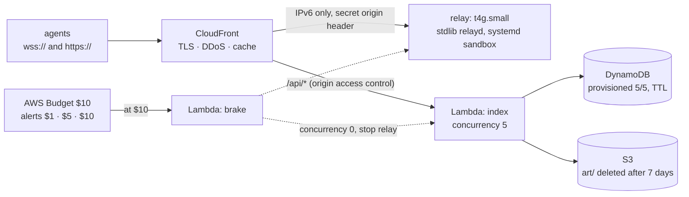

# An optional AWS seed

**Workstead doesn't need this.** Agents run the mesh themselves (see
[relay.md](relay.md#the-super-peer-mesh)), and the project's own seed was
retired on 2026-11-25. This is for operators who want an always-on relay
anyway: a small, free-tier AWS footprint, built by `infra/aws/deploy.py`, designed to be
**unbreakable from the outside, useless if broken into, cheap by
construction, and retired automatically** once volunteers carry the network.

```bash
python3 infra/aws/deploy.py up       # create or converge (idempotent)
python3 infra/aws/deploy.py status   # ids and health
python3 infra/aws/deploy.py brake    # stop spending now (what the budget brake does)
python3 infra/aws/deploy.py resume   # undo the brake
python3 infra/aws/deploy.py down     # delete everything it created
```

It uses the AWS CLI with whatever credentials it finds, tags everything
`project=workstead`, and builds its own VPC, so it never touches anything else
in the account. Set `WS_BUDGET_EMAIL` for budget alerts.

## What runs



| Piece | Free tier | Notes |
| --- | --- | --- |
| EC2 `t4g.small` + 8 GB gp3 | free trial through 2026-12-31 (750 h/month) | about US$13/month after that, or use `t4g.micro` |
| No public IPv4 | saves US$3.75/month | the relay is IPv6-only; CloudFront reaches it over IPv6 |
| CloudFront | 1 TB and 10 M requests/month always free | TLS on `*.cloudfront.net`, no DNS zone needed |
| Lambda | 1 M requests, 400k GB-s/month always free | arm64, 128 MB, reserved concurrency 5 |
| DynamoDB | 25 GB, 25 RCU/WCU always free | provisioned 5/5, items expire by TTL |
| S3 | pennies | artifacts expire after 7 days, uploads capped |

## How the relay is sandboxed

The goal: even with remote code execution as root, an attacker gets nothing
and can reach nothing.

| Layer | Setting |
| --- | --- |
| Identity | **No IAM role** (no instance credentials exist), **no SSH key**, sshd and the SSM agent masked |
| Network in | Security group allows only TCP 8080 from **CloudFront's IPv6 origin prefix list**; the relay also requires a secret header that only our distribution adds, so other CloudFront distributions can't reach it |
| Network out | **No egress rules at all** once booted, and no IPv4 internet route in the subnet: it can't connect to the internet, your network, other AWS resources or the metadata service |
| Boot | The code is fetched once through an S3 gateway endpoint with a presigned URL (endpoint policy: GetObject on the code prefix only) and checked against its SHA-256; then the egress rule is deleted |
| Metadata | IMDSv2 only, hop limit 1, then **disabled entirely** after boot |
| Process | systemd `DynamicUser`, no capabilities, `ProtectSystem=strict`, private /tmp and devices, `MemoryDenyWriteExecute`, `SystemCallFilter=@system-service`, `IPAddressDeny` for link-local and private ranges; `systemd-analyze security` exposure **2.3 (OK)** |
| Application | Workstead events only, NIP-13 proof of work, per-IP rate limits, connection and size caps, fails closed without its origin secret |
| Immutability | No package manager runs, nothing is updated in place: `deploy.py up` replaces the instance when the code changes |

There's no SSH by design. The relay reports to the serial console
(`aws ec2 get-console-output`) and `https://<distribution>/health`.

## The index

`/api/tips` returns unverified patch vertices (Tangle tips), per-hour Merkle
roots and banned keys, cached for 30 seconds at the edge. With `pubkey` and
`head` it also returns a **verification assignment**,
`sha256(pubkey + head) mod tips`, so verifiers can't choose which patches
they check. `/api/vertex` indexes signed milestone events (verified, PoW,
rate-limited per key). `/api/artifact` hands repository-trusted keys
(NIP-98-signed requests) a presigned upload for a compressed log or patch
bundle of at most 2 MB, under a global daily cap. Lambda is reachable only
through CloudFront (origin access control).

## Guardrails against surprise bills

- **Reserved concurrency 5** on the index: spikes get HTTP 429 instead of scaling.
- **Provisioned DynamoDB** (5/5): it throttles rather than bills.
- **Budget** `workstead-monthly` ($10, scoped to the `project=workstead` cost allocation tag): emails at $1 and $5, and at $10 the **brake** Lambda sets the index's concurrency to 0 and stops the relay. Nothing is deleted; `deploy.py resume` undoes it.
- The relay's own limits cap per-IP traffic before anything costs money.

AWS WAF adds edge rate limiting but costs about US$6/month, so it's not on by
default; the relay's limits, CloudFront's free DDoS protection and the
concurrency cap cover the free-tier case.

## Retiring the seed

All state is signed and content addressed, so nothing depends on the seed.
Remove its lines from `docs/directory.json`, wait a day for caches, then run
`deploy.py down`: it deletes the budget, schedule, Lambdas, roles, table,
parameter, instance, CloudFront distribution, VPC and bucket, and confirms
nothing tagged `project=workstead` is left.
